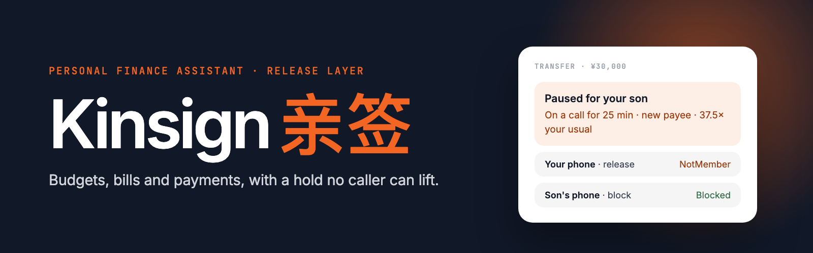
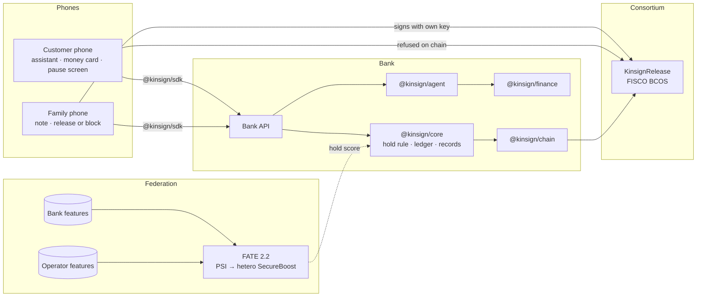

<p align="center"></p>

# Kinsign · 亲签

**A personal finance assistant with a release layer for payments made under pressure.** The assistant tracks the month, checks bills, keeps budgets and prepares payments in Chinese, English and Indonesian. When a risky payment is made during a live phone call or screen share, the money waits, and only a person the customer trusted before the call began can release it, from their own phone.

[](tsconfig.base.json)
[](#running-it)
[](contracts)
[](#testing)
[](#testing)
[](docs/guides/fisco-bcos.md)
[](federation)
[](bench/results)

| | |
|---|---|
| **Both phones side by side** | `/stage` on the local demo ([Quick start](#quick-start)) |
| **Documentation** | `/docs` on the demo, or [`docs/`](docs) on GitHub |
| **Measured results** | `/benchmarks` on the demo, or [`bench/results/`](bench/results) |
| **One session on FISCO BCOS, every step logged** | [`bench/results/sandbox-fisco.md`](bench/results/sandbox-fisco.md) |
| **The assistant against a live model, 19 of 19** | [`bench/results/assistant-live.md`](bench/results/assistant-live.md) |
| **Permission tiers and every known risk** | [`docs/security.md`](docs/security.md) |

---

## Contents

[Overview](#overview) · [The solution](#the-solution) · [One payment, end to end](#one-payment-end-to-end) ·
[The assistant](#the-assistant) · [Architecture](#architecture) · [The rules, and where each one lives](#the-rules-and-where-each-one-lives) ·
[The hold rule](#the-hold-rule) · [The release record on FISCO BCOS](#the-release-record-on-fisco-bcos) ·
[The federated score on FATE](#the-federated-score-on-fate) · [Results](#results) · [Quick start](#quick-start) ·
[Known limits](#known-limits) · [Security review](#security-review) · [Tech stack](#tech-stack) ·
[Repository structure](#repository-structure) · [Testing](#testing) · [Running it](#running-it) ·
[Roadmap](#roadmap) · [Third-party components](#third-party-components) · [Licence](#licence)

---

## Overview

In a phone scam the victim usually makes the transfer herself. The caller says he is the police, the bank, or her son in trouble, keeps her on the line, tells her to keep it secret, and walks her through the app. Face, PIN and one-time code all pass, because the genuine customer is acting. UNODC puts online scam losses in East and Southeast Asia, Australia and New Zealand at USD 88–114 billion in 2025.

Every in-app control today hands the decision to the person the caller controls at that moment. A warning is tapped through, because the caller announced it. A 30-second pause expires while he keeps talking. A confirmation question is answered as instructed. A guardian alert tells the family after the money has gone.

What works in the physical world is a second person outside the call: China's police and banks recorded 28.2 million in-person interventions between 2021 and 2025. An AI assistant that pays on request makes the gap wider, because it removes the last pause between a coached instruction and settlement.

**Kinsign moves the one decisive step, the release, to someone the caller cannot reach.**

---

## The solution

- **Everyday money, by asking.** "How much did I spend this month?", "any problem with my bills?", "pay 260 to State Grid electricity". The assistant reads her statement, flags a bill that rose or was charged twice, tracks budgets at the current pace, and prepares payments for her to confirm.
- **A narrow hold.** A payment is held only when a coercion channel is open (a call, a screen share, a remote-control app, or the 30 minutes after a long call from an unknown number) **and** it carries a risky feature: a new payee, an unusual amount, a flagged account, or a call total past its cap. Bills, saved payees and payments off a call go straight through.
- **Release from outside the call.** A held payment is released or blocked only by a member of her trusted circle, signing from their own device. Her own phone cannot release it, and neither can the bank's key.
- **A circle the caller cannot rewrite.** A new member waits 72 hours and every existing member is alerted and can veto.
- **No release by time.** If nobody answers, the bank calls her back on the number it already had, after the call ends.
- **A record nobody controls alone.** The circle, every hold and every decision live in a contract on FISCO BCOS that the bank shares with the mobile operator and the regulator, with salted hashes only.
- **A sharper score without sharing data.** Bank and operator train one hold score with FATE: private set intersection, then hetero SecureBoost over encrypted gradients.

> Authentication proves who is acting. Kinsign adds the rule an AI payment agent needs: when the person instructing it is being coached, the money waits for someone outside the conversation.

---

## One payment, end to end

| When | What happens | Where |
|---|---|---|
| Any time | She asks the assistant about her month; it reads the statement and answers with the amounts | `@kinsign/finance` `financeView`, agent tools `spending_summary`, `bills`, `budgets_and_tips` |
| On a call, 25 minutes in | She asks the assistant to send ¥30,000 to a stranger "because the officer said so"; it names the scam and drafts nothing | `@kinsign/agent` system prompt and offline rules |
| Same call | She types the transfer herself; the hold rule sees the call, the new payee and 37.5× her usual amount | `core/policy.ts` `decide` |
| A second later | The bank reserves the money and opens the hold on chain with the operator key | `core/engine.ts` → `KinsignRelease.openHold` |
| On her pause screen | She can answer three questions or write in her own words; every "yes" is attested, and answers only add risk | `POST /api/interview/text` → `KinsignRelease.attest` |
| On her son's phone | He reads a short note in his language: the amount, the call, her answers, and the advice to call her on a known number | `POST /api/holds/summary` |
| If she tries | Her own release is sent and refused on chain | `KinsignRelease.release` → `NotMember` |
| He decides | He blocks (money returns) or releases (money leaves) from his own key | `KinsignRelease.blockHold` / `release`, then `POST /api/holds/sync` |
| If nobody answers | After the response window the bank escalates; the review desk decides after a call-back | `KinsignRelease.escalate`, `reviewDecide` |

---

## The assistant

The assistant is the customer's everyday money helper. Its seven tools read or draft, and that list is the whole of its authority:

| Tool | Reads or prepares |
|---|---|
| `get_account` | Balance, reserved amount, saved payees |
| `recent_payments` | Payments that went through |
| `paused_payments` | Holds and their reasons |
| `spending_summary` | This month and last month, by category against her three-month average |
| `bills` | Regular bills found from the statement, with a rise or a double charge flagged |
| `budgets_and_tips` | Budgets projected to the end of the month, and ranked advice with a prepared action |
| `draft_transfer` | A transfer for her to confirm; it moves no money |

Sending, releasing, approving, setting a budget and changing the circle belong to people. A draft becomes a transfer only when she presses **Confirm**, and that tap goes through the same hold rule with the phone's call state, so a draft made during a scam call is held like one she typed. Advice never acts by itself: a suggested budget is saved on her tap, and a suggested transfer to savings becomes a draft.

**Budgets, bills and insights** come from pure functions in [`@kinsign/finance`](packages/finance), so the phone, the assistant and the tests read the same numbers:

| Step | Rule |
|---|---|
| Categorise | 12 categories by payee name in Chinese, English and Indonesian; moving money to savings is not spending |
| Bills | A payee in a bill category paid in at least two of the last three months; flagged when this month is 25% above usual, or the same amount was charged twice within seven days |
| Budgets | Spending projected to the end of the month at the current pace: `watch` when the projection passes the limit, `over` when spending does |
| Advice | Ranked act → watch → info, at most six, each with its evidence; a category running 40% above usual suggests a budget, a surplus suggests savings |

The model sits behind `ModelPort`. `offline` (the default) runs deterministic rules in three languages with no network; `claude` runs Claude through the Anthropic SDK (`claude-opus-5-5`, low effort, cached system prompt) with the same tools and limits. See [Payment assistant](docs/concepts/assistant.md) and [Budgets, bills and insights](docs/concepts/money.md).

---

## Architecture



**Dependencies point one way.** `protocol` depends on nothing. `core`, `chain`, `sdk`, `finance` and `agent` depend on `protocol`; `agent` also reads `finance`. `api` combines `core`, `chain`, `finance` and `agent`; `bench` combines `core`, `chain` and `sdk`. `web` uses `sdk`. `core` reaches the contract only through `ReleaseLedgerPort`, which `chain` implements against the contract and the unit tests implement in memory.

| Package | Job |
|---|---|
| [`@kinsign/protocol`](packages/protocol) | Wire types and API paths, shared by server and clients. Types only |
| [`@kinsign/core`](packages/core) | Hold rule, interview ratchet, mock bank ledger, salted records, the engine that opens and settles holds |
| [`@kinsign/chain`](packages/chain) | `KinsignRelease` client for anvil and FISCO BCOS, revert decoding, funding |
| [`@kinsign/finance`](packages/finance) | Monthly summary, bills, budgets and insights from a statement |
| [`@kinsign/agent`](packages/agent) | The assistant, the interview reader and the family note; offline or Claude |
| [`@kinsign/sdk`](packages/sdk) | Typed API client, device keys, signed decisions |
| [`apps/api`](apps/api) | Bank HTTP API, input validation, the devices' RPC proxy |
| [`apps/web`](apps/web) | Site, documentation, benchmarks and the two-phone demo |

---

## The rules, and where each one lives

| Rule | Enforced in | Refusal | Checked by |
|---|---|---|---|
| **I1** The holder never releases her own hold, and the bank's key never releases | `KinsignRelease.release`, `_requireCircle` | `NotMember` | Foundry unit tests and invariants, 162 scenario cases |
| **I2** A new member waits 72 hours; every member can veto; the holder's removals are timelocked | `proposeMember`, `vetoMember`, `removeMember` | `NotMember` | Foundry tests, scenario corpus |
| **I3** The interview only raises risk | `core/policy.ts`, `api/http/validate.ts`, `agent/interview.ts` | — | `policy.test.ts`, `validate.test.ts`, `interview.test.ts` |
| **I4** Nothing is released by time alone | `escalate`, `reviewDecide` | `WindowOpen`, `NotReviewer` | `test_timeAloneNeverReleases` over 365 days |
| **I5** Every transition extends a per-hold hash chain | `_move`, `attest`; `core/records.ts` | — | `records.test.ts`, every scenario recomputes the chain |
| A release binds payee, amount and transfer id | transfer digest in `release`, `reviewDecide` | `DigestMismatch` | `test_approvalBoundToTransfer` |
| Money moves only by the contract's state | `core/engine.ts` `sync` | — | `engine.test.ts` |
| The bank cannot decide for a device | device keys stay on the device (`sdk/device.ts`) | — | the API holds only the operator and reviewer keys |
| The assistant reads and drafts, never sends or sets | its tool list (`agent/tools.ts`) | — | `assistant.test.ts`, live run |
| A draft is sent once | claimed before the transfer (`api/routes/assistant.ts`) | HTTP 409 | sandbox log, step 9 |
| A caller cannot raise her norm | payments on a channel never enter the norm (`core/ledger.ts`) | — | `engine.test.ts` |
| Advice acts only on her tap | `finance/insights.ts`, `api/routes/finance.ts` | HTTP 400 | `finance.test.ts` |

---

## The hold rule

```text
held  ⇔  channel open  ∧  ( new payee  ∨  amount > 3 × norm  ∨  paid on this channel + amount > 5 × norm  ∨  flagged payee )  ∧  score ≥ θ
         or the duress PIN was entered
```

| Setting | `CORE_POLICY` | Meaning |
|---|---|---|
| `normMultiple` | 3 | One transfer above this multiple of her usual payment is unusual |
| `afterCallSeconds` | 1,800 | How long the channel stays open after a call |
| `afterCallMinSeconds` | 300 | Shorter calls open no after-call window |
| `channelCapMultiple` | 5 | What she may pay on one channel, as a multiple of her usual payment |
| `holdThreshold` | 0 | The core holds every triggered transfer; the federated score lets a bank raise it |

The norm is the median of her recent payments. Payments made while a channel is open stay out of it, so a caller cannot have her make a few payments first to raise the bar. Every hold carries its reasons, for example `on a call for 25 min`, `a 40-min call ended 3 min ago`, `30,000 already sent during this call`. See [Holds](docs/concepts/holds.md).

---

## The release record on FISCO BCOS

A release decides who bears a loss, and the sending bank, the receiving bank, the operator, the regulator and the family can disagree about it. `KinsignRelease` keeps the record on a consortium chain run by those parties, so no single party, the bank included, can skip the timelock or rewrite who released the money.

| Function | Caller | Effect |
|---|---|---|
| `enroll(holder, members[])` | operator | Registers a customer with her initial circle |
| `proposeMember(member)` | holder | Starts the 72-hour timelock; a pending proposal cannot be restarted |
| `vetoMember(holder, member)` | member | Stops a pending addition |
| `removeMember(holder, member)` | member / holder | Immediate from a member, timelocked from the holder |
| `openHold(id, holder, digest, record)` | operator | Opens a hold; ids are single-use |
| `release(id, digest, record)` | member | Releases; the digest must match the held transfer |
| `blockHold(id, record)` | member | Blocks; the money returns |
| `cancel(id, record)` | holder | Withdraws the transfer; always allowed |
| `escalate(id, record)` | operator | Moves to review, only after the response window |
| `reviewDecide(id, approve, digest, record)` | reviewer | Decides a hold already in review |
| `attest(id, record)` | operator | Appends an interview, note or debrief record |

**On chain:** circle membership and timelocks, hold states and the decider, a per-hold hash chain of salted records. **With the bank:** names, phone numbers, amounts, payees and interview text, disclosed with their salt only in a dispute. FISCO BCOS specifics (zero-balance senders, revert data in `error.data`) are handled in `@kinsign/chain` and `@kinsign/sdk`; see [FISCO BCOS](docs/guides/fisco-bcos.md).

---

## The federated score on FATE

The phone knows a call is live and cannot see the number. The operator knows the number's history and nothing about the payment. [`federation/federated.py`](federation/federated.py) joins them on FATE 2.2:

1. **Alignment.** ECDH PSI on the customer's own number and the minute of the event, which both parties hold. Operator calls that never led to a transfer stay hidden.
2. **Training.** Hetero SecureBoost, bank as guest with the labels, operator as host; gradients are Paillier-encrypted, so the operator never sees labels or bank features.
3. **Live score.** The operator returns partial tree outputs for the current call; the bank completes the score.

| Hold score | AUC, strong operator signals | Friction at matched loss | AUC, weak signals | Friction, weak |
|---|---|---|---|---|
| Rule score (`core/policy.ts`) | 0.940 | 6.4 m ¥ | 0.940 | 6.4 m ¥ |
| SecureBoost, bank only | 0.948 | 4.2 m ¥ | 0.948 | 4.2 m ¥ |
| **SecureBoost, bank + operator** | **0.998** | **0.71 m ¥ (−83%)** | 0.969 | 3.9 m ¥ (−7%) |

The lift is worth what the operator actually knows about scam numbers, so it is reported under both settings. See [Federation](docs/guides/federation.md).

---

## Results

Every published number has a file in [`bench/results/`](bench/results), and the demo's `/benchmarks` page reads those files directly.

**Scenario corpus, as real transactions.** 75 scams (five typologies × Chinese, English, Indonesian × five caller tactics) and 24 legitimate payments against the deployed contract.

| Network | Cases | Passed | Scam value attempted | Lost | Refused on chain | Transactions |
|---|---|---|---|---|---|---|
| anvil, same bytecode, time travel | 99 | 99 | ¥1,845,000 | ¥0 | 90 | 430 |
| FISCO BCOS 3.16.4, four nodes | 63 | 63 | ¥1,107,000 | ¥0 | 45 | 226 |

**Population model, one million customers for one year** (coached victims, mid friction costs):

| Defence | Loss rate | Legitimate payments held | Net benefit |
|---|---|---|---|
| In-call warning | 100% | 0% | −0.79 m ¥ |
| Warning + 30-second pause | 100% | 0% | −0.003 m ¥ |
| Money lock, 10% adoption | 90.6% | 0.7% | −25.5 m ¥ |
| **Kinsign core** | **8.7%** | **1.1%** (median wait 9 min) | **+18.6 m ¥** |

**Sandbox session on FISCO BCOS** ([`sandbox-fisco.md`](bench/results/sandbox-fisco.md)): finance view and tips, a budget she sets, a bill paid through the assistant, a second tap refused, a coached request answered with a warning, her own ¥30,000 held, her release refused on chain (`NotMember`), her son's block, and a rent payment on a call that her son releases, 18 steps with a transaction hash for every decision.

**The assistant against a live model** ([`assistant-live.md`](bench/results/assistant-live.md)): 19 of 19 cases in three languages, covering spending, bills and advice, payments, scam requests, prompt injection, the interview reader and the family note. Every check is code. The run found two prompt gaps, a reply in the wrong language and a draft announced without the tool call; both are fixed in the system prompt.

[Reproduce the benchmarks](docs/guides/benchmarks.md) explains every run.

---

## Quick start

Requirements: Node.js 22+ and [Foundry](https://getfoundry.sh); `scripts/setup.sh` installs Foundry when it is missing.

```bash
git clone https://github.com/youvandra/kinsign.git && cd kinsign
scripts/setup.sh                # submodules, npm ci, forge build

npm run dev:api                 # bank API on :8620, with its own local chain
npm run dev:web                 # http://localhost:5190
```

| Page | What it shows |
|---|---|
| `/stage` | Both phones side by side, with scenes for a bill, a "police" call, a "son in hospital" call and a real landlord |
| `/phone` | The customer's phone: balance, assistant, the month's money and tips, transfers, the pause screen |
| `/family` | The trusted person's phone: the family note, release or block |
| `/docs` | The documentation, with search |
| `/benchmarks` | The measured results |

Try it: on `/stage`, ask the assistant "any tips for this month?", then pick the "police" scene, send the transfer, and try to release it from the customer's phone.

---

## Known limits

- **The bank and the operator are simulated.** The ledger is a mock and the operator's call data is synthetic, generated from documented scam typologies, so the federated lift shows how the trade-off works; a pilot measures the real one.
- **Call state comes from a toggle in the web demo.** A native iOS app reading `CXCallObserver` and screen-capture state is the next build; the demo reports the same fields to the same API.
- **A fooled or colluding trusted person can release.** The family note shows the call, the payee and her answers and advises a call-back on a known number. In the population model net benefit stays positive at low and mid costs up to 20% of reached members fooled.
- **An addition nobody vetoes for 72 hours becomes a member.** Every member is alerted at once; one contract test states this on purpose.
- **Scams paid days after the last call fall outside the trigger.** The after-call window covers the "hang up and pay now" tactic; the population model credits none of it, so its loss figure for investment scams (31.8%) is an upper bound.
- **The demo API serves one fixed customer with no authentication**, and `/api/demo/*` can warp time and decide reviews. A bank deployment sits behind its own session authentication and ships without the demo routes.
- **All four FISCO BCOS nodes run on one machine.** The shared record earns its assurance when parties with different interests run the nodes.

---

## Security review

**Permission tiers.** Each actor holds exactly the authority its role needs, enforced by code paths that do not exist rather than by checks that could be skipped.

| Tier | Actor | Can | Cannot |
|---|---|---|---|
| 0 | Assistant | Read, explain, advise, draft | Send, release, approve, set a budget, change the circle |
| 1 | Customer, her device key | Confirm a draft, transfer, set a budget, cancel her hold, propose a member | Release her own hold, add a member in under 72 h |
| 2 | Circle member, own key | Release or block a hold opened while a member, veto, remove a member | Act on a hold opened before they became effective |
| 3 | Bank risk engine, operator key | Enrol, open a hold, escalate after the window, attest | Release, sign for a member, skip a timelock |
| 4 | Bank review desk | Decide a hold already in review | Decide a hold the circle still has |
| 5 | Operator, regulator nodes | Read the shared record | Change it |

**Found while building, and fixed**

| # | Finding | Fix |
|---|---|---|
| 1 | Payments made during a call entered the customer's norm, so a caller could raise the bar with a few small payments first | On-channel payments stay out of the norm; an engine test drives three payments on one call and the third is held |
| 2 | A double tap on Confirm could send an assistant draft twice | The draft is claimed before the transfer and reopened only if it fails; a second confirm returns 409 |
| 3 | Splitting a large transfer into small ones to known payees passed every check | A per-channel cap adds up everything paid since the channel opened |
| 4 | "Hang up, then pay" left the channel closed | The 30-minute after-call window |
| 5 | On FISCO BCOS a refused release surfaced as `reverted`, hiding the reason | Revert data in `error.data` is decoded with the ABI on the device and in the chain client |
| 6 | Supermarket trips twice a month were flagged as a double charge | Bills are bill categories only; a double charge is the same amount within seven days |
| 7 | The live model answered an English request in Chinese, and once announced a draft it never made | The system prompt fixes the reply language and allows "prepared" only after `draft_transfer` returned |

The full known-risk list, with the status of each, is in [`docs/security.md`](docs/security.md).

---

## Tech stack

| Layer | Technology | Why this one |
|---|---|---|
| Release record | Solidity 0.8.24, Foundry, FISCO BCOS 3.16.4 (4 nodes, PBFT) | a permissioned consortium chain run by known institutions, with an EVM and finality in about a second |
| Federation | FATE 2.2: ECDH PSI, hetero SecureBoost, Paillier | the bank and the operator hold the two halves of the signal and may share neither |
| Backend | Node 22+, TypeScript (strict), viem 2 | one language from the hold rule to the phone, with shared wire types |
| Assistant | Anthropic SDK (`claude-opus-5-5`), or offline rules | tool use with strict schemas; the model is a port, so a bank can plug in its own |
| Web | React 18, React Router 7, Vite 5, Tailwind 3, motion | the two phones, the documentation and the benchmarks in one app |
| Quality | Vitest, Foundry fuzz and invariant tests, ESLint, Prettier | each guarantee has a test that would fail without it |

---

## Repository structure

```
kinsign/
├── apps/
│   ├── api/          Bank HTTP API: routes, validation, RPC proxy; src/eval/ holds the live assistant run
│   └── web/          Site, docs, benchmarks and the two-phone demo
├── packages/
│   ├── protocol/     Wire types and API paths. Types only
│   ├── core/         Hold rule, ledger, salted records, engine. Pure
│   ├── chain/        KinsignRelease client for anvil and FISCO BCOS
│   ├── finance/      Monthly summary, bills, budgets and insights. Pure
│   ├── agent/        Assistant, interview reader, family note (offline or Claude)
│   └── sdk/          API client, device keys, signed decisions
├── bench/            Scenario corpus, population model, sandbox session, FATE export; results/
├── contracts/        KinsignRelease.sol with Foundry unit and invariant tests
├── federation/       FATE 2.2 job: PSI and hetero SecureBoost between bank and operator
├── infra/fisco/      Local four-node FISCO BCOS chain
├── scripts/          setup.sh for a fresh checkout
└── docs/             Documentation in Markdown, served by the web app at /docs
```

---

## Testing

```bash
npm run typecheck && npm run lint && npm run format:check
npm test                          # Vitest, 78 tests
(cd contracts && forge test)      # 21 unit tests + 2 invariants over 8,192 random calls
npm run bench:scenarios           # 99 cases as real transactions on anvil
```

| Suite | Tests | Covers |
|---|---|---|
| `contracts/test/KinsignRelease.t.sol` | 21 | one test per rule: holder and operator cannot release, digest binding, 72-hour timelock, veto, removals, time alone never releases, escalation window, review, cancel, final states, hash chain, single-use ids |
| `contracts/test` invariants | 2 | a coached holder and an accomplice, 128 runs × 64 calls: never a release by the holder, never by the accomplice before a full unvetoed timelock |
| `packages/core/test` | 30 | hold rule, after-call window, channel cap, interview ratchet, ledger, records, engine |
| `packages/finance/test` | 13 | categories, monthly summary, bill detection and flags, budget projection, ranked insights in three languages |
| `packages/agent/test` | 17 | tool list, model loop with a scripted model, offline replies in three languages, interview reader |
| `packages/sdk/test` | 6 | client, signed decisions |
| `apps/api/test` | 4 | input validation, yes-only interview |
| `apps/web/test` | 6 | documentation sidebar against the files, internal links |
| `bench/test` | 2 | the seeded generator behind the population model |

A CI workflow ([`.github/workflows/ci.yml`](.github/workflows/ci.yml)) runs the checks on every push. [`CONTRIBUTING.md`](CONTRIBUTING.md) has the conventions.

---

## Running it

### Environment

| Variable | Used by | Default |
|---|---|---|
| `PORT` | bank API | `8620` |
| `KINSIGN_RPC` | bank API, benchmarks | unset: the API starts its own anvil |
| `KINSIGN_ANVIL_PORT` | bank API | `8548` |
| `KINSIGN_ASSISTANT` | bank API | `offline`; `claude` calls the Anthropic API (billed) |
| `ANTHROPIC_API_KEY` | Claude mode, live run | or an `ant auth login` profile |
| `KINSIGN_API` | sandbox session | `http://localhost:8620` |

### On FISCO BCOS

```bash
infra/fisco/setup.sh && infra/fisco/start.sh                 # local four-node chain
KINSIGN_RPC=http://127.0.0.1:8545 npm run dev:api
KINSIGN_RPC=http://127.0.0.1:8545 npm run bench:scenarios
```

### Benchmarks and runs

```bash
npm run bench:scenarios                                      # scenario corpus
npm run bench:population                                     # population model
npm run bench:sandbox                                        # one session through the SDK, against a running API
npm run eval:assistant -w @kinsign/api                       # the assistant against a live model (billed)
npm run bench:fate-export                                    # CSVs for the FATE job; run it as in federation/README.md
```

### Claude mode

```bash
KINSIGN_ASSISTANT=claude npm run dev:api
```

---

## Roadmap

1. **Native iOS app** reading `CXCallObserver` and screen-capture state, embedding `@kinsign/sdk`.
2. **Post-call debrief** by voice, once the caller is off the line.
3. **Pilot with one bank and one operator**, replacing the synthetic data and measuring the federated lift.
4. **Differentially private PSI** and batched live queries, to shrink what the operator learns.
5. **A public coercion benchmark**, so other defences can be compared on how often the victim released her own money.

---

## Third-party components

| Component | Licence | Used for |
|---|---|---|
| [FATE](https://github.com/FederatedAI/FATE) | Apache-2.0 | PSI and hetero SecureBoost |
| [FISCO BCOS](https://github.com/FISCO-BCOS/FISCO-BCOS) | Apache-2.0 | the consortium chain |
| [forge-std](https://github.com/foundry-rs/forge-std) | MIT / Apache-2.0 | contract tests |
| [viem](https://github.com/wevm/viem) | MIT | chain clients |
| [Anthropic TypeScript SDK](https://github.com/anthropics/anthropic-sdk-typescript) | MIT | Claude mode |
| [React](https://github.com/facebook/react), [Vite](https://github.com/vitejs/vite), [Tailwind CSS](https://github.com/tailwindlabs/tailwindcss) | MIT | the web app |

All data in this repository is synthetic and labelled as such.

---

## Licence

Copyright © 2026 the Kinsign authors. All rights reserved.
